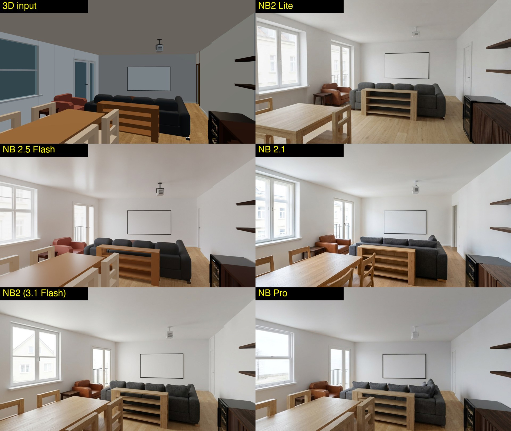
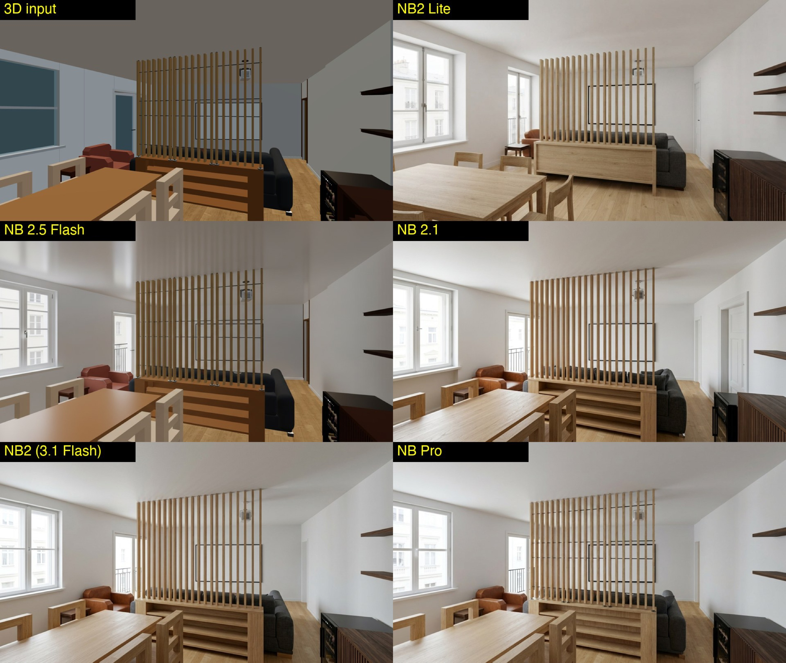
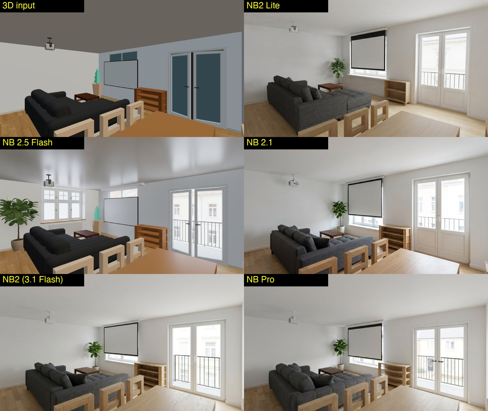
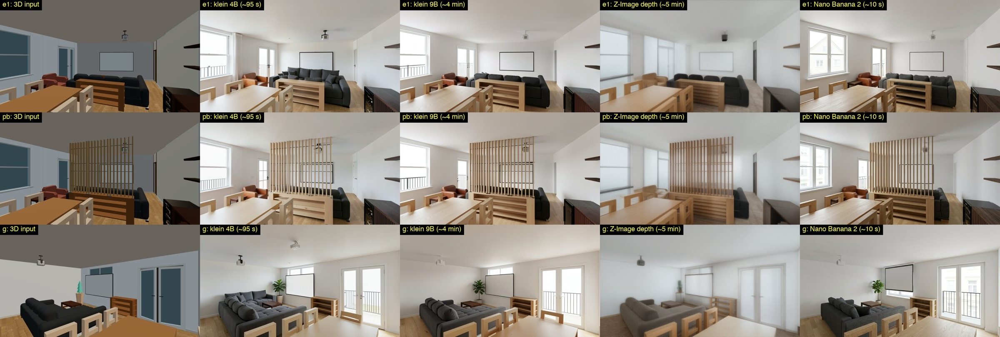
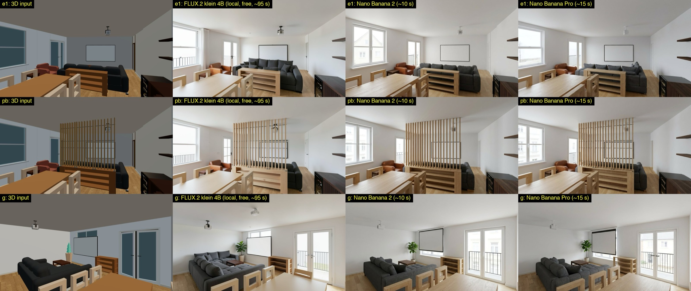
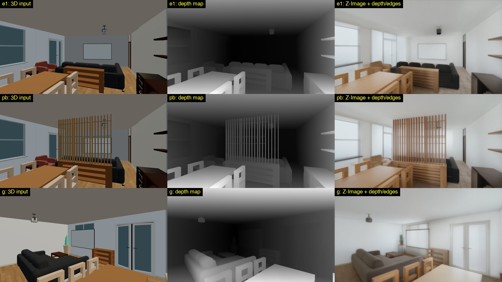

# AI render model evaluation (2026-11-08)

Which image model should turn a 3D view into a realistic interior photo? We tested on Malina's flat
(alternatives E1, Partition B and G of project `p5u3vw6o`). Every model got the same 1376×774 capture of
the 3D view, the sofa's product photo where the model accepts a reference image, and the same prompt:
a re-texturing brief listing every visible item. Temperature was 0.2 for Gemini.

The images are in [ai-render-evaluation/](ai-render-evaluation/).

## Result

**Use Nano Banana 2 (`gemini-3.1-flash-image`) for drafts and retries, and Nano Banana Pro
(`gemini-3-pro-image`) for the final render of a view.** That is now the app's default and the order of its
model menu (`AI_MODELS` in `src/lib/components/viewer3d/ThreeViewer.svelte`).

## Gemini image models

| Model | Time | Approx. price / image | Result |
|---|---|---|---|
| Nano Banana 2 (`gemini-3.1-flash-image`) | 8–13 s | ~$0.07 | Keeps camera and layout almost exactly, photoreal. Best value. |
| Nano Banana Pro (`gemini-3-pro-image`) | 15–16 s | ~$0.13 | Just as faithful, slightly more refined. Finals. |
| Nano Banana 2.1 (`gemini-nano-banana-2.1`) | 17–19 s | ~$0.03 + thinking | Photoreal, but pulls the camera back and reframes. Slowest. |
| Nano Banana 2 Lite (`gemini-3.1-flash-lite-image`) | ~4 s | cheapest | Very fast, but recomposes the shot every time. |
| Nano Banana 2.5 Flash (`gemini-2.5-flash-image`, the old default) | ~9 s | ~$0.04 | Barely re-textures: keeps the toy-like 3D look. In G it added a window and a plant. |

Prices are from third-party aggregators, so check Google's pricing page; times and quality are from this test.
None of the models drew the wide window as a casement: all of them made it a sash window.

## Local models on an M1 Max (64 GB), via mflux 0.24

| Model | Time | Memory | Result |
|---|---|---|---|
| FLUX.2 klein 4B (Apache-2.0) | ~95 s | ~11 GB | Holds geometry well and uses the sofa photo, but adds things: window railings, a curtain, a second projector, an extra chair. |
| FLUX.2 klein 9B (non-commercial licence, gated) | ~4 min | ~22 GB | Clearly better than 4B: one projector, right screen, closer materials. Still adds a fourth chair in G and the window railing. |
| Z-Image Turbo + depth/edge ControlNet (Apache-2.0) | 5–9 min | — | Geometry locked pixel for pixel and nothing added, but hazy; the screen disappears, the leather armchair becomes wood, the French door a sliding door. Gentler guidance is sharper but loses more. Text-to-image only, so no product photo. |
| FLUX.2 dev | — | — | Not runnable: mflux doesn't support it, and the official files (~113 GB without the single-file copy) don't fit beside everything else. The only MLX ports are unknown third-party uploads. |

## Takeaways

- **Local models aren't worth it as the main path.** klein 9B is the best free fallback, for when credits run
  out or offline use. It's about 25× slower than Nano Banana 2, still adds items, and its licence rules out
  shipping it in openPlan3D. All local models were deleted after the test.
- **Product photos matter.** The sofa, the only item with a product photo, came out right in every
  photoreal model. Every furniture item should carry a product page and photo; the item panel now warns when
  one is missing.
- **Depth locking works, but the open model is too weak.** A better use of our exact 3D geometry is an
  automatic check: compare a render's edges or depth with the 3D view and reject renders that added or moved
  things (the window railings and extra chairs above). This works with any model; it isn't built yet.
- **Fix in the scene, not in the prompt.** Every model struggles where the 3D view disagrees with the prompt
  (grey walls described as white, brown doors described as white). White walls and doors and the real oak in
  the 3D materials would leave the model less to reinterpret.
- **Check credits first.** Prepaid Gemini credits ran out mid-session (HTTP 402 "prepayment credits are
  depleted"); a cheaper draft model stretches them.
